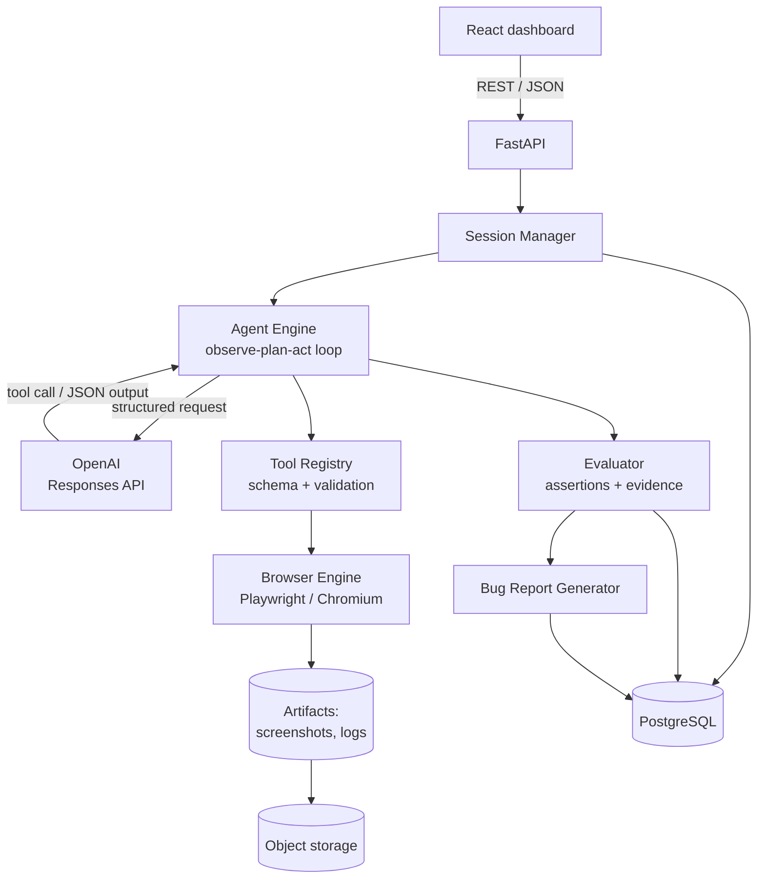

# TestPilot AI — Architecture

This document explains how TestPilot AI is structured and *why*. It is updated at the end of every
week, and whenever an architectural decision changes.

---

## 1. The problem shape

An LLM is good at reading a page and deciding what to try next. It is bad at being trusted with
side effects. So the system splits responsibilities:

- **The model decides** what to test and which tool to call next.
- **Deterministic code executes and verifies** — every browser action goes through a validated tool,
  and every pass/fail comes from an explicit assertion plus captured evidence.

That split is the core design constraint. Everything below serves it.

---

## 2. System overview



Request lifecycle in words:

1. The user posts a URL plus a testing objective.
2. The **Session Manager** validates the target (scheme, allow-list, SSRF checks) and creates a
   session with hard limits: max steps, max duration, max actions.
3. The **Website Inspector** opens the page and turns the DOM into a compact, model-readable
   observation (title, URL, visible text, interactive elements, accessibility hints).
4. The **AI Planner** turns that observation plus the objective into an ordered testing strategy.
5. The **Test Case Generator** emits structured, schema-validated test cases.
6. The **Agent Engine** runs the loop: ask the model for the next tool call, validate the arguments,
   execute the tool, feed the result back as an observation.
7. The **Evaluator** checks each test against explicit assertions; the model may explain results but
   cannot by itself mark a test passed.
8. The **Bug Report Generator** turns verified failures into structured reports with reproduction
   steps and evidence links.
9. Everything is persisted, and the dashboard reads it back.

---

## 3. Backend layering

```
app/
  api/routes/     HTTP surface only: parse request → call a service → return schema
  schemas/        Pydantic models: the API contract, validated on the way out
  core/           configuration, logging, security utilities
  services/       business logic (sessions, planning, evaluation)      [later]
  agent/          the execution loop and its state machine             [later]
  browser/        Playwright engine + tool implementations             [later]
  db/             SQLAlchemy models, engine, repositories              [later]
```

Rules:

- Route handlers contain **no business logic** and never touch the browser or the LLM directly.
- Services depend on abstractions, not on FastAPI request objects, so they are unit-testable.
- Only `core/` reads environment variables; everything else receives configuration.

Day 1 implements `api`, `schemas` and `core` only. A `main.py` app factory (rather than a module-level
app with side effects) keeps tests and future background workers able to build their own instance.

---

## 4. The agent loop

```
OBSERVE → PLAN → SELECT TOOL → EXECUTE → OBSERVE RESULT → EVALUATE → CONTINUE | FINISH
```

Per-step state, held by the Session Manager (not by the model):

| Field | Why it exists |
| --- | --- |
| `step` | Enforces `max_steps`; makes the loop provably finite |
| `deadline` | Wall-clock budget, independent of step count |
| `history` | Tool calls + results, replayed into context and stored for audit |
| `plan` | Lets the model re-plan without losing the objective |
| `visited_urls` | Prevents loops on the same page |
| `action_counts` | Detects repeated identical actions (thrashing) |

Guardrails, all deterministic:

- Hard cap on steps, duration and tool calls per session.
- Repeated-identical-action detection aborts the run with an `agent_loop_detected` error.
- Tool arguments are validated against a Pydantic schema before anything executes; an invalid call is
  returned to the model as an error observation instead of crashing the run.
- Navigation targets are re-validated after every redirect.
- The model can only reach the registered tool set. No shell, no arbitrary Python, no file system.

---

## 5. Evidence over opinion

A test result has three parts:

1. **Assertion** — machine-checkable, e.g. "URL contains `/dashboard`", "element `#error` is visible",
   "response status is 200".
2. **Observation** — what the browser actually reported at that moment.
3. **Verdict** — derived from (1) and (2) by code, not by the model.

When a verdict is `fail`, the evidence bundle is frozen: screenshot, console errors, failed network
requests, and the step trace. The LLM then writes the human-readable explanation *about* that bundle.
This is what keeps false positives low enough to be measurable on Day 19.

Failures are classified into three buckets, because they have different owners:

| Class | Meaning | Example |
| --- | --- | --- |
| `application_bug` | The site behaved incorrectly | Valid registration rejected with 500 |
| `test_assumption` | The test expected something the site never claimed | Test assumed a specific button label |
| `automation_error` | The tooling failed | Navigation timeout, selector no longer attached |

Only the first class becomes a bug report.

---

## 6. Data model (target)

```
TestingSession 1─* TestPlan 1─* TestCase 1─1 TestExecution 1─* Evidence
                     │                        │
                     └──────────────* BugReport *──────────┘
```

- `TestingSession`: url, objective, status, limits, timings, cost.
- `TestCase`: id, name, description, preconditions, steps, expected result, priority.
- `TestExecution`: status (passed/failed/skipped/error), duration, classification, actual result.
- `Evidence`: screenshots, console errors, network failures, step trace (stored in S3, referenced here).
- `BugReport`: title, severity, reproduction steps, expected vs actual, evidence links.

Day 3–4 build the browser observations that later fill this model; Day 6 persists it.

---

## 7. Security boundaries

Threats: the target site is untrusted content, and the LLM can be steered by that content
(prompt injection).

- **Untrusted input:** page text is passed to the model as data with explicit delimiters, and never as
  instructions. Tool calls are validated regardless of what the page said.
- **SSRF:** resolve the hostname first, reject private/loopback/link-local ranges and non-HTTP schemes,
  re-check every redirect hop. Same rule for any URL the model proposes.
- **Containment:** the browser runs with a fixed tool set, per-action timeouts, and no download or
  file-system access. No shell, no `eval`, no arbitrary Python from model output.
- **Secrets:** server-side only, read from the environment, never echoed in responses or logs.
- **Budget:** every session is capped, so a hostile page cannot run up an unbounded LLM bill.

---

## 8. Decision log

| Day | Decision | Reason |
| --- | --- | --- |
| 1 | FastAPI app factory + router aggregator | Testable, and new resources never touch `main.py` |
| 1 | `pydantic-settings` for config | Typed, validated at startup, `.env` support without ad-hoc `os.environ` code |
| 1 | CORS from configuration, not `*` | Explicit origins; wildcard + credentials is unsafe and masks misconfiguration |
| 1 | Separate runtime vs dev requirements | Keeps the deployable image free of test tooling |
| 1 | Vite + React + TypeScript | Fast dev loop, first-class TS, and the stack shadcn/ui expects on Day 5 |
| 1 | Only `/health` implemented | Nothing is exposed before it works |

---

## 9. Deliberately not built yet

Database, Redis, Celery, Docker, auth, LLM calls and browser automation all arrive on their scheduled
days. The frontend currently renders one placeholder screen with a live backend health probe; the real
dashboard replaces it on Day 5.
